 

**Desenvolvedor Back-end em formação**

Construindo soluções com lógica, código e propósito.

 

 

 

## Sobre

Sou estudante de Técnico em Desenvolvimento de Sistemas no SENAC, com foco em desenvolvimento back-end e no ecossistema C#/.NET.

Venho construindo minha base técnica por meio de estudos complementares e projetos práticos, aplicando conceitos de programação orientada a objetos, APIs REST, persistência de dados e organização de código.

| | |
|:--|:--|
| **Formação** | Técnico em Desenvolvimento de Sistemas, SENAC |
| **Complementar** | Programador de Sistemas, Obra Social Dom Bosco |
| **Interesse** | Desenvolvimento back-end |
| **Stack principal** | C# e .NET |

 

## Stack

| Back-end | Banco de dados | Ferramentas |
|:--|:--|:--|
|       |     |     |

 

## Projetos selecionados

| Projeto | Descrição | Tecnologias |
|:--|:--|:--|
| [**LuYuAdega.API**](https://github.com/PedroInCode/LuYuAdega.API) | API em desenvolvimento para um sistema de adega, com foco em regras de negócio, persistência de dados e organização das responsabilidades da aplicação. | `C#` `.NET` `ASP.NET Core` `Entity Framework Core` |
| [**UsuariosApi**](https://github.com/PedroInCode/UsuariosApi) | API para gerenciamento de usuários, com estudos de autenticação e integração com banco de dados. | `.NET 8` `ASP.NET Core Identity` `Entity Framework Core` `MySQL` |
| [**FilmesApi**](https://github.com/PedroInCode/FilmesApi) | Projeto de estudos voltado à construção de APIs e à consolidação dos fundamentos do desenvolvimento back-end. | `C#` `.NET` `APIs REST` |

 

## Atualmente

- Aprofundando conhecimentos em C# e .NET
- Desenvolvendo APIs com ASP.NET Core
- Estudando persistência de dados com Entity Framework Core
- Aplicando orientação a objetos e separação de responsabilidades
- Evoluindo em arquitetura de software e boas práticas de desenvolvimento

 

## GitHub Analytics

  
  

  

 

---

**C# · .NET · Back-end**

<picture>
  <source media="(prefers-color-scheme: dark)" srcset="https://raw.githubusercontent.com/PedroInCode/PedroInCode/output/github-contribution-grid-snake-dark.svg" />
  <source media="(prefers-color-scheme: light)" srcset="https://raw.githubusercontent.com/PedroInCode/PedroInCode/output/github-contribution-grid-snake.svg" />
  
</picture>

